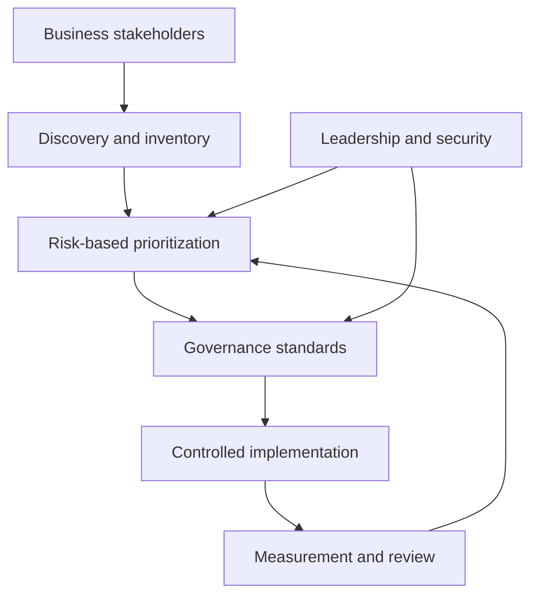

# Enterprise Microsoft 365 Governance Framework

A practical architecture and governance case study for a growing organization adopting Microsoft 365 and enterprise AI.

**Status:** Discovery and design. This is an independent portfolio project using a fictional organization, not a deployed client solution or an assessment of an actual employer.

## Business scenario

A fictional multidisciplinary professional-services organization has grown from approximately 300 to 700 employees. Collaboration sites, business applications and automated processes have expanded organically. Leadership wants to introduce AI capabilities while preserving business continuity, information security and departmental autonomy.

These are scenario assumptions to validate through discovery, not audit findings.

## Objectives

- Establish accountable ownership of sites, applications, flows and agents.
- Reduce avoidable information exposure, duplication and operational risk.
- Standardize provisioning, access review and lifecycle processes.
- Enable controlled Copilot adoption without unnecessarily delaying innovation.
- Measure governance outcomes and communicate priorities to leadership.

## Scope

| Workstream | Planned deliverable |
| --- | --- |
| Discovery and assessment | Inventory, stakeholder interviews, risk register |
| SharePoint governance | Site ownership, provisioning, sharing and lifecycle standards |
| Power Platform governance | Environment strategy, data policies, application and flow ownership |
| AI readiness | Information access assessment, pilot criteria, agent oversight |
| Operating model | Decision rights, escalation, review cadence |
| Measurement | KPI definitions and synthetic reporting dataset |

Endpoint management, network infrastructure and full tenant migration are outside the initial scope. Implementation depends on validated licensing, administrative permissions and business requirements.

## Proposed operating model

## Delivery roadmap

| Phase | Outcome |
| --- | --- |
| Days 1–30 | Assess current state, establish relationships, identify urgent risks |
| Days 31–60 | Prioritize remediation, define standards, design controlled AI pilot |
| Days 61–90 | Implement approved improvements, evaluate pilot, agree ongoing roadmap |

The timeline is illustrative and subject to discovery. Urgent security issues should be escalated immediately rather than deferred to a later phase.

## Repository documentation

- [Project charter and acceptance criteria](docs/PROJECT_CHARTER.md)
- [Development backlog](docs/BACKLOG.md)
- [GitHub issues](https://github.com/iramos85/enterprise-m365-governance/issues)

## Principles

Business needs first. Least privilege. Accountable ownership. Risk-based delivery. Maintainability. Measurable outcomes.

All examples will use synthetic data. No employer materials, tenant identifiers, credentials or proprietary configurations will be published.
